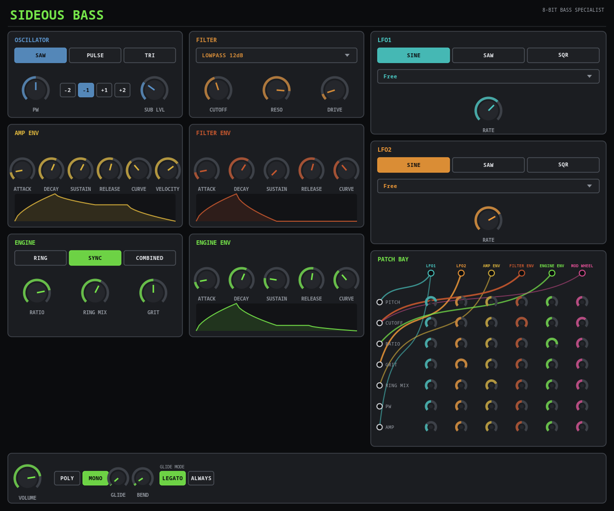

# Sideous Bass


> **⚠️ VIBE CODED SLOP.** This entire plugin — DSP, GUI, CI — was built through
> conversational back-and-forth with an AI, not hand-engineered from a spec.
> It works, it's been tested, but go in with appropriate expectations.

A bass specialist (VST3 / LV2 / CLAP / JACK standalone), built on
[DPF](https://github.com/DISTRHO/DPF) with a hand-drawn Cairo-based UI — a
companion to [Sideous](https://github.com/marcin-koziol/Sideous-synth),
[Sideous Drums](https://github.com/marcin-koziol/Sideous-drums),
[Sideous Noise](https://github.com/marcin-koziol/Sideous-noise), and
[Sideous Pad](https://github.com/marcin-koziol/Sideous-pad), same family, own
gunmetal/industrial visual identity.

The core idea: the buzzy, metallic bass heard in retro Atari/C64 game music
doesn't come from a bigger oscillator, it comes from a handful of specific
8-bit synthesis tricks. Three of them are implemented as a selectable
**Engine**:

- **Ring** — carrier × modulator (amplitude multiplication, not summation).
  Inharmonic, clangy, "ringing" metallic tones — the classic SID ring-mod
  bass trick.
- **Sync** — a master oscillator hard-resets a slave oscillator's phase every
  cycle; the slave runs at a knob-controlled ratio. Raw, buzzing,
  "screaming" sync-bass character.
- **Combined** — approximates the SID's well-known "combined waveform"
  hardware quirk: triangle and pulse bit-ANDed together at an adjustable
  quantization depth instead of playing cleanly. A **Grit** knob sweeps from
  a smooth blend to full bitcrushed crunch.



The second half of the concept: instead of fixed "LFO has one destination"
routing, modulation is a small **Patch Bay** — six sources (LFO1, LFO2, Amp
Env, Filter Env, Engine Env, Mod Wheel) freely patchable to seven
destinations (Pitch, Cutoff, Ratio, Grit, Ring Mix, Pulse Width, Amplitude),
42 depth knobs rendered as an actual jack-and-cable matrix. Turn any cell
away from zero and a colored cable animates in, tying that source's color to
everywhere it's patched — genuinely modular routing with a real visualization
of the patch, not just a menu of preset destinations.

## Features

- **Engine**: Ring / Sync / Combined, switchable, each with its own
  character knobs (Ratio shared by Ring/Sync, Ring Mix for Ring, Grit for
  Combined)
- **Patch Bay**: a 6×7 mod matrix — LFO1 / LFO2 / Amp Env / Filter Env /
  Engine Env / Mod Wheel, each patchable to Pitch / Cutoff / Ratio / Grit /
  Ring Mix / Pulse Width / Amplitude, any number of connections at once, each
  with its own -1..1 depth. Cables are drawn live between jack sockets,
  colored by source. Amp Env additionally always drives the voice's own VCA
  (that one connection is hardwired, not patchable, or the instrument would
  default to silence) — everything else is 100% patch-defined, all-zero by
  default. The classic "swept sync" bass move (bright buzzy attack settling
  to a mellower sustain ratio) is just Engine Env patched to Ratio.
- **Oscillator**: Saw / Pulse (variable pulse width) / Triangle carrier and
  modulator waveform, plus a sub-oscillator (±1/±2 octaves, adjustable level)
- **Filter**: switchable lowpass/highpass, 12dB and 24dB slopes, plus a
  simplified Moog-style ladder filter, with resonance and drive — the
  self-resonant growl pairs naturally with all three engines
- **Three envelope generators** (Amp, Filter, Engine) and **two LFOs**
  (sine/saw/square, free-running or tempo-synced 1/1–1/32 incl.
  dotted/triplet) — all six are just Patch Bay sources; what each one
  modulates is entirely up to how you patch it
- **Voice modes**: mono with portamento by default (basslines are
  conventionally monophonic), or 8-voice polyphony for stacked/chord bass —
  Legato/Always glide-mode control
- **Performance controls**: velocity sensitivity, pitch bend (configurable
  range); mod wheel is a Patch Bay source like everything else, so its
  destination(s) and depth are however you've cabled it
- Knobs show live values while being automated, not just while dragging

## Presets

A small file-based preset library lives entirely in the plugin's own UI (top
bar: `< >` to browse, a click-to-rename name field, **SAVE**, **DELETE**) —
it works identically in every format including the JACK standalone, which
has no host preset browser to lean on. Presets are plain-text `.sbpreset`
files (one `symbol=value` line per parameter) in:

- Linux: `$XDG_DATA_HOME/sideous-bass/presets` (usually `~/.local/share/sideous-bass/presets`)
- macOS: `~/Library/Application Support/sideous-bass/presets`
- Windows: `%APPDATA%\sideous-bass\presets`

**INIT** (the compiled-in defaults) sits at one end of the `< >` cycle and
isn't a real file; saving from there creates your first user preset. An
unsaved-changes marker (`*`) appears next to the name whenever a knob has
moved since the displayed preset was last loaded or saved. Five factory
presets (Deep Sub Growl, Sync Scream Lead, SID Digi Crunch, Wobble Bass,
Mono Growl Glide — one per Engine mode plus a Patch Bay routing example
each) are seeded into that directory automatically the first time the UI
runs with an empty preset library, then behave exactly like any preset you
save yourself.

## Building

```sh
git clone --recursive <repo-url>
cd sideous-bass
cmake -S . -B build
cmake --build build -j$(nproc)
```

(If you already cloned without `--recursive`, run
`git submodule update --init --recursive` first.)

Built plugins land in `build/bin/` — `sideous-bass.vst3`, `sideous-bass.lv2`,
`sideous-bass.clap`, and a JACK/native-audio standalone (`sideous-bass`).

CI ([`.github/workflows/build.yml`](.github/workflows/build.yml)) builds
Linux, Windows, and macOS (universal) packages on every push and attaches
them to GitHub Releases for tagged versions.
